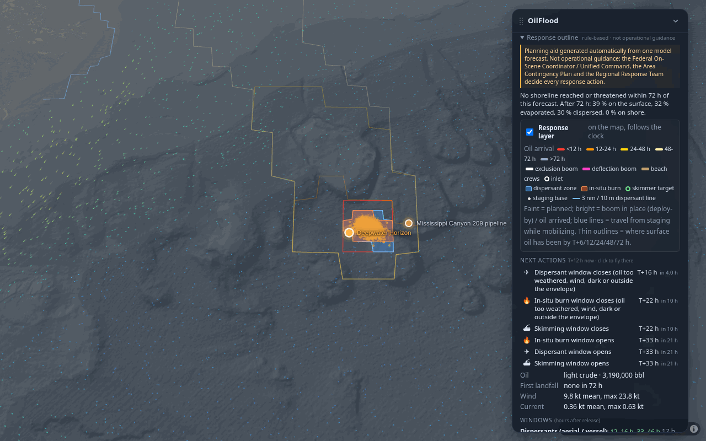

# Response outline (T16, PLAN P6)

After a prediction run (or a historical hindcast), OilFlood builds a **first-responder action outline**:
time to first landfall, priority shorelines ranked by NOAA ESI sensitivity and arrival time, where to boom first,
dispersant / in-situ burn / skimming windows, closures, and cited precedents from past Gulf spills.

> **Not operational guidance.** It is a planning aid generated from one model forecast. The Federal On-Scene
> Coordinator / Unified Command, the Area Contingency Plan and the Regional Response Team decide every response
> action. The panel and the JSON both carry this disclaimer.

## API
- `GET /api/spill/{run_id}/response` – for a prediction run (`id` from `POST /api/spill`). 202 + status while the run is
  still going, 409 if it failed.
- `GET /api/spills/{spill_id}/response?model=openoil|ours` – for a catalog spill's hindcast (starts it if needed).
  That spill's own response log is left out of its precedents.
- `?brief=0` skips the LLM layer.
- Cached as `backend/runs/<id>/response.json` (rebuilt when `response.VERSION` changes); LLM text in `briefing.json`.

Main keys: `disclaimer`, `headline[]`, `spill` (oil class, volume, horizon, forecast), `eta_first_landfall_h`,
`first_landfall`, `budget[]` (% surface / evaporated / dispersed / stranded at 6/12/24/48/72 h),
`priority_shorelines[]`, `boom_first[]`, `tactics.{dispersant,in_situ_burn,mechanical}` (`windows[]` in hours after
release + UTC, `not_applicable`, `conditions[]`), `conditions` (wind/current along the slick, 3-hourly series),
`closures[]`, `precedents` (`similar_spills[]`, `by_tactic.{category: [{spill, date, action, quote, src}]}`),
`sources[]`, `limits[]`, `briefing` (`text` or `null` + `note`).

`layer` (since `resp-v2`, T21) holds the map geometry, see [Response map layer](#response-map-layer-t21).

Code: `backend/app/response.py` (rules), `backend/app/response_layer.py` (map geometry), `backend/app/briefing.py` (LLM),
`web/src/outline.ts` (panel section + numbered shoreline markers), `web/src/responseLayer.ts` (deck.gl layers, labels,
Next actions).

## Inputs (all real)
| Input | Source |
|---|---|
| Particle tracks, oil budget | the run's `tracks.json` (OpenOil or our model) |
| Winds, currents along the slick | the run's own forcing files (live: GFS 0.25° winds + RTOFS currents; hindcast: HYCOM-TSIS), sampled hourly at the slick centroid |
| Shoreline sensitivity | NOAA OR&R **National ESI Shoreline** (Gulf/Atlantic ESIL, 2017 compilation of the state ESI atlases 1996–2017), `NationalESI_Shoreline.zip` from https://response.restoration.noaa.gov/esi_download |
| Place names | US Census Bureau 2023 Gazetteer (places) |
| Precedents | `data/spills/catalog.json` response logs (NOAA IncidentNews posts, verbatim quotes, T13) |

### ESI derivative (`data/esi/gulf_esi_cells.json`, 127 KB, committed)
`data/build_esi.py` reads the 413k Gulf ESI shoreline features (TX, LA, MS, AL and the Florida Gulf coast incl.
Florida Bay/Keys; estuarine/marine shoreline lines only) and bins them into 0.05° cells (~5 km): 2,686 cells,
127,500 km of mapped shoreline (most of it Louisiana marsh). Per cell: length-weighted centroid, shoreline km,
**most sensitive ESI class**, length-dominant class, km of ESI 10 wetlands, state atlas + year. ESI labels come from the
data's own `LANDWARD_SHORETYPE` strings. The 237 MB download + 393 MB unzipped GDB stay in `data/raw/` (gitignored).
`data/esi/gulf_places.json` (24 KB): 632 Census places within ~12 km of that shoreline.

## Rules
### Landfall, threat and priority shorelines
- A **stranded** particle's last position is matched to the nearest ESI cell within 6 km → landfall, ETA = stranding
  time. Mass per stranded particle = stranded mass at the end of the run / stranded particles.
- **Threatened**: surface oil (hourly positions) within 10 km of a shoreline cell (nearest cell only, so the outer
  coast, not the bay behind it), ETA = first approach.
- Cells are grouped into stretches of ≤ ~30 km, seeded at the most-oiled cells, and named by the nearest Census place.
- Sensitivity tier from the stretch's most sensitive ESI class (NOAA ESI guidelines: higher = more sensitive, longer
  oil persistence, harder cleanup): **tier 1** ESI 9–10 (sheltered flats, marshes, swamps, mangroves), **tier 2** ESI 7–8
  (exposed flats, sheltered rocky/riprap/structures), **tier 3** ESI 1–6 (beaches, exposed/armored shores).
- Ranking: landfall (≥ 0.5 % of particles) before merely threatened → tier → earliest arrival. This follows the
  usual ACP protection-priority logic (protect the most sensitive habitat the oil reaches first).
- Each stretch carries a shoreline treatment note by ESI class (marsh: exclusion boom, no foot traffic or cutting,
  low-pressure flushing/sorbents, natural recovery; sand beaches: manual/mechanical removal, protect inlets behind
  them; riprap/structures: flushing, sorbents; flats: natural recovery, avoid trampling), summarised from NOAA ORR
  *Characteristics of Response Strategies* (2010) and the NOAA Shoreline Assessment Manual.

### Boom first
Top 5 landfall stretches in priority order. Action by tier (exclusion/deflection boom at inlets and marsh openings;
boom sheltered shore + stage skimmers; protect inlets behind beaches + beach crews). If oil arrives in < 6 h (assumed
boom staging time) the item says it is likely too late and to protect the next stretch / send shoreline crews.

### Windows (hourly, at the slick centroid)
Oil types map to groups (≈ ITOPF/NOAA persistence groups): gasoline, condensate, jet fuel (non-persistent),
diesel, light / medium / heavy crude, heavy fuel oil (IFO 380, No. 6).

| Tactic | Oil-age limit by type | Weather / other limits |
|---|---|---|
| Dispersant | light crude ≤ 48 h, medium ≤ 36 h, heavy crude ≤ 12 h; not for gasoline/condensate/jet/diesel (evaporate/disperse naturally); heavy fuel oil: generally too viscous (test first, RRT approval) | wind 4–25 kt, daylight, ≥ 3 nm from shore and ≥ 10 m deep at the slick centroid (RRT 4/6 pre-authorization zone; depth from ETOPO1 since resp-v2) |
| In-situ burn | light crude ≤ 48 h, medium ≤ 36 h, heavy crude ≤ 24 h, heavy fuel ≤ 12 h, diesel ≤ 24 h; not for gasoline/condensate/jet | wind ≤ 20 kt, daylight, ≥ 3 nm offshore; needs fire boom to ≥ 2–3 mm, < ~25 % water in emulsion, waves < ~3 ft (not modelled) |
| Boom + skimmers | all but gasoline/condensate/jet | wind ≤ 20 kt, daylight; containment boom loses oil above ~0.75 kt relative current (mean/max current reported) |

The oil-age limits are the "window of opportunity" figures commonly given for dispersants and burning before
evaporation and emulsification raise viscosity / water content (NOAA ORR *Characteristics of Response Strategies*;
NOAA *Dispersants: A Guided Tour*; ITOPF TIP 4 *Use of dispersants*; NOAA/USCG *In-situ Burning* guidance and the
RRT 6 FOSC in-situ burn and dispersant pre-authorization plans). Daylight = solar elevation > 0 at the slick
(NOAA solar position approximation).

### Closures
- USCG safety zone over the slick extent (bbox at 24/48/72 h).
- Navigation: any surface oil within 15 km of a listed channel entrance (Brazos Santiago … Key West, approximate
  coordinates in `response.py`) → "consider traffic restriction / boom across the entrance" with ETA (precedent:
  Houston Ship Channel closure after Texas City Y, 2014).
- Fishery/shellfish: for persistent oils or any landfall: precautionary closure over the slick + oiled/threatened coast,
  with the state agencies of the affected states and NOAA Fisheries.
- Gasoline/condensate/jet: vapour/fire hazard first (LEL monitoring, keep clear, shelter-in-place downwind).

### Precedents
Catalog spills are scored by oil-group match (+2 same group, +1 neighbouring), size similarity (+≤1.5, by log ratio
of volumes) and distance (+≤1 within 400 km). For each recommended tactic the earliest matching action of the best
spills is cited with its date, verbatim quote and IncidentNews URL.

## Response map layer (T21)

The outline of the run on screen (live prediction or historical hindcast; OpenOil or ours; in Compare the first finished
model, as for the text outline) is drawn on the globe and follows the time slider. Panel: **Response layer** checkbox
(on by default after a run, remembered in localStorage `oilflood.resp.v1`), legend, and **Next actions**: the next 6 timeline
events with T+ hours and "in N h", click = fly there. The disclaimer stays at the top of the section.

| Map element | What it is | Clock behaviour |
|---|---|---|
| Shoreline arrival | real NOAA ESI shoreline lines (GULF_ATLANTIC_ESI.gdb, bbox read per stretch, simplified ~30 m) in every oiled / threatened 0.05° cell, coloured by that cell's ETA: < 12 h red, 12–24 orange, 24–48 yellow, 48–72 pale, > 72 grey; ESI 9–10 drawn slightly wider | faint before the ETA, bright + wider once oil arrives |
| Offshore arrival outlines | union of 0.05° cells that surface oil has entered by T+6/12/24/48/72 h | outline brightens when passed |
| Boom plan | for each `boom_first` site: ESI lines within 2 km of where particles strand, clipped to ~2 km around the stranding points, capped at 8 km per site (display; the real length comes from the Geographic Response Plan / survey). Type by line: ESI 7–10 → **exclusion** boom (white); if the forecast current at the site at the ETA > 0.7 kt → **deflection** boom (magenta) at angle asin(0.7 / current) to the current; ESI 1–6 → **beach crews** (tan, no boom on the surf line). Channel entrances (`PORT_ENTRANCES`) within 25 km → **exclusion boom across the entrance** (white ring). Label: "deploy by T+x h · from <base> ~y h" | faint (planned) until deploy-by, then bright; "too late for boom" if mobilize-by < 0 |
| Dispersant zone (blue) | ~2 km cells holding surface oil while the dispersant window is open at that hour (oil age, wind 4–25 kt, daylight) AND inside the pre-authorization envelope: ≥ 3 nm from shore AND ≥ 10 m deep | per 3 h step; disappears when the window closes |
| In-situ burn zone (orange) | cells with ≥ 0.2 % of the particles (collectable oil) while the burn window is open (oil age, wind ≤ 20 kt, daylight) AND ≥ 3 nm from shore | per 3 h step |
| 3 nm / 10 m line (thin blue) | seaward edge of the dispersant envelope around the slick | static |
| Skimmer targets (green rings) | 3 densest surface-oil clusters (3×3 cells ≈ 6 km, ≥ 1 % of particles, ≥ 12 km apart); dim when the skimming window is closed (wind > 20 kt / night) | per 3 h step |
| Staging | all 54 bases as dots (USCG white, depots light blue); a line from the nearest equipment base (OSRO / state depot or USCG small-boat station; offices and air stations are not used for boom) to each boom site | line bright between mobilize-by and deploy-by |

Timeline (`layer.timeline[]`, sorted): mobilize-by and deploy-by per boom site (or "too late"), boom across inlets, landfall per
priority stretch (≥ 0.5 % of particles), dispersant / burn / skimming window opens and closes (dispersant/burn only when a zone
exists in the envelope at that time).

### Rules and sources
- **Deploy-by** = predicted arrival − 2 h (boom anchored and tended before the oil arrives). **Mobilize-by** = deploy-by − travel
  from the nearest equipment base (straight line × 1.3 at 30 km/h) − 1 h loading. These are stated planning assumptions; for
  context, OSRO response-time tiers are 12/36/60 h in higher volume port areas (33 CFR 155.1050) and facilities must have
  1,000 ft of boom on scene within 1 h (33 CFR 154.1045).
- **Boom types**: containment / deflection / exclusion as defined in NOAA ORR *Characteristics of Response Strategies* (2010,
  p. 39); boom failure above ~0.7 kt normal current (NOAA ORR; ITOPF TIP 03 says ~1 kt); deflection angle from ITOPF TIP 03
  (*Use of Booms in Oil Pollution Response*): 90° at 0.7 kt, 45° at 1 kt, 28° at 1.5 kt, 20° at 2 kt = asin(0.7 / U).
- **Dispersant pre-authorization**: RRT-6 (TX, LA) *FOSC Dispersant Pre-Approval Guidelines and Checklist v4.0* (2001; still
  referenced by the 2015 RRT6 playbook): "offshore waters from the ten-meter isobath or three nautical miles, whichever is
  farthest from the shore, to 200 nautical miles"
  (https://www.glo.texas.gov/sites/default/files/2025-07/rrt6.pdf). Closer in: RRT-6 2005 *Near Shore Environment Dispersant
  Expedited Approval* (not a pre-authorization). RRT-4 (MS, AL, FL) 1996 policy "green zone": ≥ 3 mi from shore and ≥ 10 m
  deep (a newer RRT-4 policy could not be verified). The Flower Garden Banks NMS has its own RRT-6 guidance (Appendix 43) and is
  not mapped. We apply "≥ 3 nm AND ≥ 10 m" everywhere in the Gulf (US rules; Mexican/Cuban waters are outside both RRTs).
- **In-situ burn**: RRT-6 *In-Situ Burn Policy for the Offshore Environment* (Appendix 13, 2020): "seaward beginning three
  miles offshore"; the 1994 RRT VI plan excludes areas near certain reefs and off Grand Isle (not mapped). RRT-4 1995 "A zone":
  ≥ 3 mi seaward, federal waters.
- **Depth and distance to shore**: NOAA NCEI ETOPO1 (1 arc-min) via CoastWatch ERDDAP (`data/fetch_bathy.py` →
  `data/cache/bathy/etopo1_gulf.npz`, gitignored). Distance = nearer of the ETOPO1 coastline pixels and the ESI shoreline cells.
  The hourly dispersant window now also requires ≥ 10 m at the slick centroid. If the bathymetry is missing, depth is not
  checked and the JSON + legend say so.
- **Staging bases** (`data/response/staging_bases.json`, committed, 37 KB): 37 USCG units (positions = OpenStreetMap facility
  footprints, cross-checked with the US Census Geocoder where an address exists), 9 MSRC equipment sites (MSRC Equipment Site Map),
  2 Clean Gulf Associates bases, 6 Texas GLO oil-spill warehouses (GLO *Prestaged Equipment and Staging Areas*). Every entry has
  `src` + `coord_src`; inland offices are flagged in `note`. It is not a list of available equipment.
- Verbatim quotes, page numbers and URLs for all of the above: docs/RESPONSE_RULES_SOURCES.md.

### Limits of the layer
- One deterministic run: zones, boom sites and times move with every new forecast.
- Boom sites follow our generic rule, not the official Geographic Response Plans (TX GLO, LA ACP) that pre-define boom
  strategies per inlet; responders would use those.
- Raw ESI geometry comes from `data/raw/esi_x` (237 MB download, gitignored). Without it the arrival map falls back to 5 km
  ESI cell dots and no boom lines are drawn (the JSON says so in `layer.notes`).
- Travel times are straight-line estimates; no road/waterway routing, no traffic, no vessel availability.
- Waves are not modelled (burn and boom limits depend on them); slick thickness is approximated by particle density.
- ETOPO1 (~1.8 km) blurs the nearshore 10 m line; bays the ocean model treats as land are not resolved.

## LLM briefing (optional)
`briefing.py` sends the compacted outline JSON (no hourly series) to an LLM with instructions to use only the facts in
it, ≤ 170 words, most urgent first, ending "Planning aid only, not operational guidance." Key from the environment
only: `XAI_API_KEY` (xAI, default `grok-3-mini`), `OPENAI_API_KEY` (`gpt-4o-mini`) or `ANTHROPIC_API_KEY`
(`claude-haiku-5-5`); `OILFLOOD_LLM_MODEL` overrides the model. Also read from `backend/.env` (gitignored).
No key → `briefing.text = null` and the panel shows the rule-based outline only (no placeholder text).

## Limits
- One deterministic forecast run per model; real oil can go elsewhere. Compare OpenOil vs ours and re-run as forecasts
  update.
- Stranding happens on the model coastline (GSHHG / ocean-model land at ~1–4 km). Bays the ocean model treats as land
  (Galveston Bay, Barataria, Mobile Bay interiors) are not resolved; 6 km/10 km matching radii pick the outer coast.
- Waves, slick thickness and emulsion water content are not modelled; windows use wind, daylight, distance from shore,
  water depth (dispersants, ETOPO1) and oil-age limits only. Wind/current are sampled at the slick centroid, not per patch.
- `shoreline_km` is mapped ESI shoreline length inside the stretch's cells (convoluted marsh edges make it large), not
  the length oiled.
- Boom staging time (6 h), stretch size (30 km) and port proximity (15 km) are planning assumptions.
- ESI atlases date from 1996–2017; shorelines have changed since (especially Louisiana).
