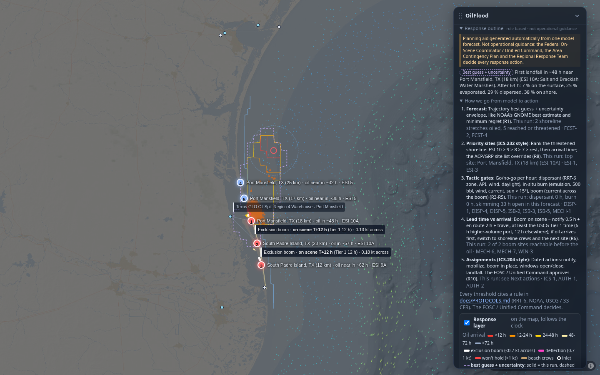
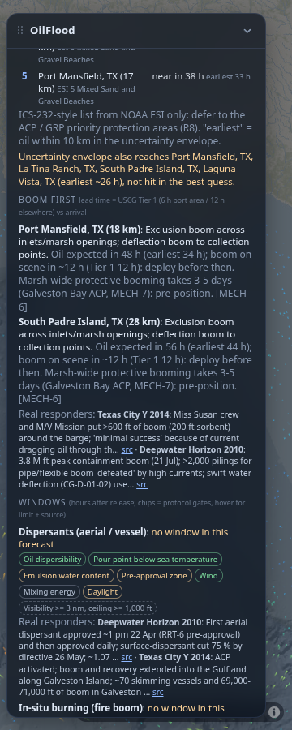
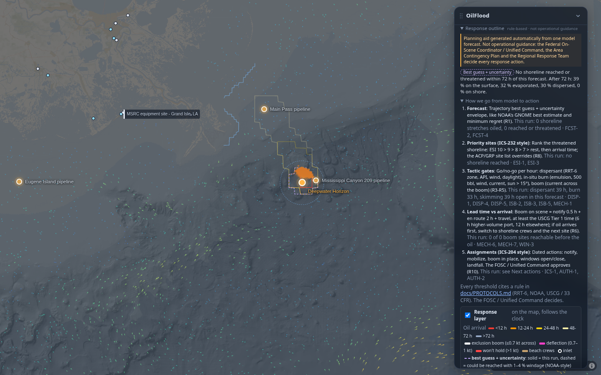
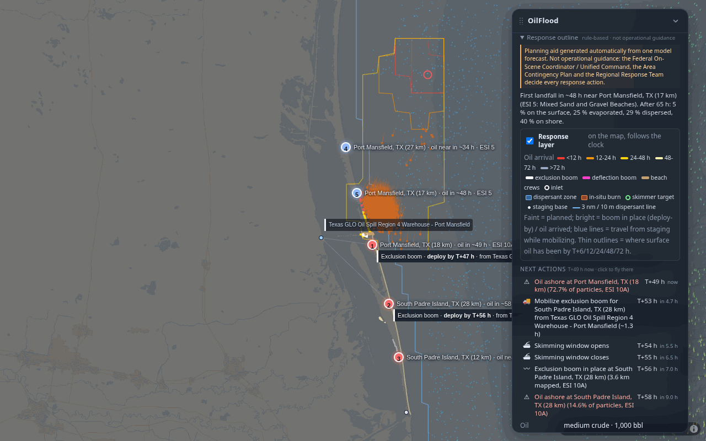

# Response outline (T16, PLAN P6)

After a prediction run (or a historical hindcast), OilFlood builds a **first-responder action outline**:
time to first landfall, priority shorelines ranked by NOAA ESI sensitivity and arrival time, where to boom first,
dispersant / in-situ burn / skimming windows, closures, and cited precedents from past Gulf spills.

> **Not operational guidance.** It is a planning aid generated from one model forecast. The Federal On-Scene
> Coordinator / Unified Command, the Area Contingency Plan and the Regional Response Team decide every response
> action. The panel and the JSON both carry this disclaimer.

## API
- `GET /api/spill/{run_id}/response` – for a prediction run (`id` from `POST /api/spill`). 202 + status while the run is
  still going, 409 if it failed.
- `GET /api/spills/{spill_id}/response?model=openoil|ours` – for a catalog spill's hindcast (starts it if needed).
  That spill's own response log is left out of its precedents.
- `?brief=0` skips the LLM layer.
- Cached as `backend/runs/<id>/response.json` (rebuilt when `response.VERSION` changes); LLM text in `briefing.json`.

Main keys: `disclaimer`, `headline[]`, `spill` (oil class, volume, horizon, forecast), `eta_first_landfall_h`,
`first_landfall`, `budget[]` (% surface / evaporated / dispersed / stranded at 6/12/24/48/72 h),
`priority_shorelines[]`, `boom_first[]`, `tactics.{dispersant,in_situ_burn,mechanical}` (`windows[]` in hours after
release + UTC, `not_applicable`, `conditions[]`), `conditions` (wind/current along the slick, 3-hourly series),
`closures[]`, `precedents` (`similar_spills[]`, `by_tactic.{category: [{spill, date, action, quote, src}]}`),
`sources[]`, `limits[]`, `briefing` (`text` or `null` + `note`).

`layer` (since `resp-v2`, T21) holds the map geometry, see [Response map layer](#response-map-layer-t21-protocol-gates-t23).

Code: `backend/app/response.py` (rules), `backend/app/response_layer.py` (map geometry), `backend/app/briefing.py` (LLM),
`web/src/outline.ts` (panel section + numbered shoreline markers), `web/src/responseLayer.ts` (deck.gl layers, labels,
Next actions).

## Inputs (all real)
| Input | Source |
|---|---|
| Particle tracks, oil budget | the run's `tracks.json` (OpenOil or our model) |
| Winds, currents along the slick | the run's own forcing files (live: GFS 0.25° winds + RTOFS currents; hindcast: HYCOM-TSIS), sampled hourly at the slick centroid |
| Shoreline sensitivity | NOAA OR&R **National ESI Shoreline** (Gulf/Atlantic ESIL, 2017 compilation of the state ESI atlases 1996–2017), `NationalESI_Shoreline.zip` from https://response.restoration.noaa.gov/esi_download |
| Place names | US Census Bureau 2023 Gazetteer (places) |
| Precedents | `data/spills/catalog.json` response logs (NOAA IncidentNews posts, verbatim quotes, T13) |

### ESI derivative (`data/esi/gulf_esi_cells.json`, 127 KB, committed)
`data/build_esi.py` reads the 413k Gulf ESI shoreline features (TX, LA, MS, AL and the Florida Gulf coast incl.
Florida Bay/Keys; estuarine/marine shoreline lines only) and bins them into 0.05° cells (~5 km): 2,686 cells,
127,500 km of mapped shoreline (most of it Louisiana marsh). Per cell: length-weighted centroid, shoreline km,
**most sensitive ESI class**, length-dominant class, km of ESI 10 wetlands, state atlas + year. ESI labels come from the
data's own `LANDWARD_SHORETYPE` strings. The 237 MB download + 393 MB unzipped GDB stay in `data/raw/` (gitignored).
`data/esi/gulf_places.json` (24 KB): 632 Census places within ~12 km of that shoreline.

## Rules
### Landfall, threat and priority shorelines
- A **stranded** particle's last position is matched to the nearest ESI cell within 6 km → landfall, ETA = stranding
  time. Mass per stranded particle = stranded mass at the end of the run / stranded particles.
- **Threatened**: surface oil (hourly positions) within 10 km of a shoreline cell (nearest cell only, so the outer
  coast, not the bay behind it), ETA = first approach.
- Cells are grouped into stretches of ≤ ~30 km, seeded at the most-oiled cells, and named by the nearest Census place.
- Sensitivity tier from the stretch's most sensitive ESI class (NOAA ESI guidelines: higher = more sensitive, longer
  oil persistence, harder cleanup): **tier 1** ESI 9–10 (sheltered flats, marshes, swamps, mangroves), **tier 2** ESI 7–8
  (exposed flats, sheltered rocky/riprap/structures), **tier 3** ESI 1–6 (beaches, exposed/armored shores).
- Ranking: landfall (≥ 0.5 % of particles) before merely threatened → tier → earliest arrival. This follows the
  usual ACP protection-priority logic (protect the most sensitive habitat the oil reaches first).
- Each stretch carries a shoreline treatment note by ESI class (marsh: exclusion boom, no foot traffic or cutting,
  low-pressure flushing/sorbents, natural recovery; sand beaches: manual/mechanical removal, protect inlets behind
  them; riprap/structures: flushing, sorbents; flats: natural recovery, avoid trampling), summarised from NOAA ORR
  *Characteristics of Response Strategies* (2010) and the NOAA Shoreline Assessment Manual.

### Boom first (resp-v3, T23)
Top 5 landfall stretches in priority order. Action by tier (exclusion/deflection boom at inlets and marsh openings;
boom sheltered shore + stage skimmers; protect inlets behind beaches + beach crews). **Lead time** (PROTOCOLS.md R6, MECH-6):
boom on scene = 0.5 h notification + 2 h until Tier 1 is en route + road travel from the nearest equipment base at 35 mph
(33 CFR 154 App. C), never sooner than the USCG Tier 1 time from discovery: **6 h in a higher-volume port area, 12 h
elsewhere** (33 CFR 154.1045(f); port areas from 154.1020: Galveston Bay/Houston Ship Channel, Sabine-Neches, Lake Charles,
Corpus Christi, Mississippi River SW Pass to Baton Rouge, LOOP, Pascagoula; the CFR names them without boundaries, the boxes
in `app/protocols.py` are our approximations). If the oil (best guess) arrives before that, the item says go to shoreline
crews and the next site. Each item also gives the earliest plausible arrival from the uncertainty envelope. Marsh sites
(ESI 9-10) add the Galveston Bay ACP figure: protective booming of marsh tributaries takes 3-5 days (MECH-7).

### Tactic gates (hourly, resp-v3, T23)
The invented oil-age windows of resp-v1/v2 are gone (PROTOCOLS.md GAP-2). Every hour with surface oil is checked against
the real go/no-go gates; each gate is in `tactics.<t>.gates[]` with label, limit, rule IDs, source IDs and hours
pass / fail / unknown. Gates that need data the run does not have (waves, visibility, cloud ceiling, burn thickness after
collection) are "unknown" (grey "check" chips) and do not block the window. All values live in `backend/app/protocols.py`.

| Tactic | Gate | Limit | Rule (PROTOCOLS.md) |
|---|---|---|---|
| Dispersant | API gravity (ADIOS record the model ran with) | 17-45 (< 17 difficult/impossible, > 45 no need) | DISP-5 |
| | pour point vs sea temperature (25 °C, our model's Gulf default) | below | DISP-5 |
| | emulsion water content | <= 25 % | WIN-4 / R3 |
| | pre-approval zone at the slick centroid | >= 3 nm AND >= 10 m (ETOPO1) | DISP-1, DISP-3 |
| | wind (aerial) | <= 25 kt | DISP-4 |
| | daylight | sun > 0° | DISP-4 |
| | mixing energy (advisory) | ~4 kt | DISP-8 |
| | visibility >= 3 nm, ceiling >= 1,000 ft | check | DISP-4 |
| In-situ burn | emulsion water content | <= 25 % (50 % with test burn) | ISB-2, WIN-4 |
| | surface oil in the densest ~6 km patch (3x3 cells of 0.02°) | > 500 bbl per burn | ISB-3 |
| | distance offshore | >= 3 nm | ISB-1 |
| | Grand Isle buffer (Census centroid) | > 7 mi when the wind blows toward it | ISB-1 |
| | wind | <= 21.7 kt (25 mph); preferred < 17.4 kt (advisory) | ISB-4 |
| | current | <= 0.75 kt | ISB-2 |
| | sun elevation | > 15° | ISB-5 |
| | thickness collected in fire boom, waves | 2-3 mm, <= 3 ft: check | ISB-2 |
| Boom + skimmers | daylight; short-period waves <= 2-3 ft (check) | | ISB-5, MECH-2 |

- **Emulsion** = Mackay et al. (1980) dY/dt = 2e-6 (U+1)^2 (1 - Y/Ymax) on the run's forecast wind at the slick, starting
  when the run's evaporated fraction passes the ADIOS onset (same formula and constants as `ourmodel/sim.py`). Ymax and
  onset from ADIOS (IFO-380 has Ymax 0 there, so it never emulsifies in the model).
- **Continuous releases** (a run with a point source, or a catalog spill whose release is a blowout: DWH, Ixtoc) are
  evaluated for the freshest oil at the source (emulsion 0), as GAP-2 asks: DWH burned and dispersed for weeks.
- The "most oils become hard to recover, burn or disperse within 24-48 h" statement (WIN-2) is shown as context, not a gate.
- Light products (gasoline, condensate, jet): no burn, boom or skimming (fire/explosion hazard, CRS). Diesel is not excluded
  from dispersants by the RRT-6 table (API ~34); the outline says dispersing it is a judgment call (GAP-14).
- Who decides / what must happen first is listed per tactic (FOSC + RRT-6, SMART Tier I for every dispersant use, PM10
  150 µg/m³ for burns: AUTH-1/2, DISP-6/7, ISB-7).
- Each tactic, the boom list and the closures carry `precedents`: what responders actually did at Deepwater Horizon 2010
  and Texas City Y 2014, verbatim from `data/response/protocols.json` `real_responses` with links (NOAA OSC report, NTSB).

### Uncertainty: best guess + envelope (R1)
`uncertainty` + `layer.uncertainty[]`: the run is the best guess; the envelope re-drifts the same particles with windage 1 %
and 4 % (GNOME's range, FCST-4) instead of the model's own (OpenOil 2 %, ours 3 %), using the forecast wind at the slick
centroid integrated over time. Drawn as a dashed outline (cumulative reach at T+12/24/48/72 h); shoreline cells reached
within 10 km in the envelope give `eta_earliest_h` per stretch and `envelope_only_shoreline` (places hit only in the
envelope). Labelled "Best guess + uncertainty" like NOAA: areas of possible oiling, not the extent of oil. Wind direction
and current uncertainty (also in GNOME) are not included, and NOAA's own skill note (FCST-3) plus our backtest error are shown.

### From model to action (`protocol`)
The panel's "How we go from model to action" explainer (forecast -> ICS-232-style priority sites -> tactic gates -> lead time
vs arrival -> ICS-204-style assignments), each step filled with this run's numbers and rule IDs, linking docs/PROTOCOLS.md.

### Closures
- USCG safety zone over the slick extent (bbox at 24/48/72 h).
- Navigation: any surface oil within 15 km of a listed channel entrance (Brazos Santiago … Key West, approximate
  coordinates in `response.py`) → "consider traffic restriction / boom across the entrance" with ETA (precedent:
  Houston Ship Channel closure after Texas City Y, 2014).
- Fishery/shellfish: for persistent oils or any landfall: precautionary closure over the slick + oiled/threatened coast,
  with the state agencies of the affected states and NOAA Fisheries.
- Gasoline/condensate/jet: vapour/fire hazard first (LEL monitoring, keep clear, shelter-in-place downwind).

### Precedents
Catalog spills are scored by oil-group match (+2 same group, +1 neighbouring), size similarity (+≤1.5, by log ratio
of volumes) and distance (+≤1 within 400 km). For each recommended tactic the earliest matching action of the best
spills is cited with its date, verbatim quote and IncidentNews URL.

## Response map layer (T21, protocol gates T23)

The outline of the run on screen (live prediction or historical hindcast; OpenOil or ours; in Compare the first finished
model, as for the text outline) is drawn on the globe and follows the time slider. Panel: **Response layer** checkbox
(on by default after a run, remembered in localStorage `oilflood.resp.v1`), legend, and **Next actions**: the next 6 timeline
events with T+ hours and "in N h", click = fly there. The disclaimer stays at the top of the section.

| Map element | What it is | Clock behaviour |
|---|---|---|
| Shoreline arrival | real NOAA ESI shoreline lines (GULF_ATLANTIC_ESI.gdb, bbox read per stretch, simplified ~30 m) in every oiled / threatened 0.05° cell, coloured by that cell's ETA: < 12 h red, 12–24 orange, 24–48 yellow, 48–72 pale, > 72 grey; ESI 9–10 drawn slightly wider | faint before the ETA, bright + wider once oil arrives |
| Offshore arrival outlines | union of 0.05° cells that surface oil has entered by T+6/12/24/48/72 h | outline brightens when passed |
| Boom plan | for each `boom_first` site: ESI lines within 2 km of where particles strand, clipped to ~2 km around the stranding points, capped at 8 km per site (display; the real length comes from the Geographic Response Plan / survey). Type by line: ESI 7–10 → **exclusion** boom (white); if the forecast current at the site at the ETA > 0.7 kt → **deflection** boom (magenta) at angle asin(0.7 / current) to the current; ESI 1–6 → **beach crews** (tan, no boom on the surf line). Channel entrances (`PORT_ENTRANCES`) within 25 km → **exclusion boom across the entrance** (white ring). Label: "deploy by T+x h · from <base> ~y h" | faint (planned) until deploy-by, then bright; "too late for boom" if mobilize-by < 0 |
| Dispersant zone (blue) | ~2 km cells holding surface oil while all hour-level dispersant gates pass (API, pour point, emulsion, wind <= 25 kt, daylight) AND >= 3 nm from shore AND >= 10 m deep | per 3 h step |
| In-situ burn zone (orange) | ~2 km cells >= 3 nm offshore with > 500 bbl in the ~6 km patch around them, outside the Grand Isle buffer (onshore wind) and > 3 mi from any Census place, while emulsion, wind, current and sun > 15° pass | per 3 h step |
| Uncertainty (dashed lilac) | cumulative reach with windage 1-4 % at T+12/24/48/72 h | latest envelope reached by the clock |
| 10 nm circle (dashed blue) / Grand Isle 7 mi (dashed orange) | RRT-6 dispersant planning circle around the source (DISP-2); ISB buffer (ISB-1), drawn when the slick is within 150 km | static |
| 3 nm / 10 m line (thin blue) | seaward edge of the dispersant envelope around the slick | static |
| Skimmer targets (green rings) | 3 densest surface-oil clusters (3×3 cells ≈ 6 km, ≥ 1 % of particles, ≥ 12 km apart); dim when the skimming window is closed (night) | per 3 h step |
| Staging | all 54 bases as dots (USCG white, depots light blue); a line from the nearest equipment base (OSRO / state depot or USCG small-boat station; offices and air stations are not used for boom) to each boom site | line bright between mobilize-by and deploy-by |

Timeline (`layer.timeline[]`, sorted): mobilize-by and deploy-by per boom site (or "too late"), boom across inlets, landfall per
priority stretch (≥ 0.5 % of particles), dispersant / burn / skimming window opens and closes (dispersant/burn only when a zone
exists in the envelope at that time).

### Rules and sources
- **Boom on scene** (resp-v3) = Tier 1 lead time (see "Boom first"); the map shows boom bright from then on, the timeline has
  "notify" at T+0.5 h, "Tier 1 en route" at T+2.5 h and "boom on scene" at the lead time. Late if the best-guess arrival is earlier.
- **Boom types** from the current ACROSS each boom line (component perpendicular to the ESI segment, strongest hour within
  +/-3 h of arrival, from the run's current forcing at the site or the stranding points offshore of it): <= 0.7 kt exclusion
  (MECH-1; 0.75 kt in RRT-6), 0.7-1 kt deflection boom at asin(0.7 / current) to a collection point (ITOPF TIP 03 angles),
  > 1 kt "won't hold" (ISB-6: very high loss rate): shoreline crews + skimmers downstream (R5).
- **Dispersant pre-authorization**: RRT-6 (TX, LA) *FOSC Dispersant Pre-Approval Guidelines and Checklist v4.0* (2001; still
  referenced by the 2015 RRT6 playbook): "offshore waters from the ten-meter isobath or three nautical miles, whichever is
  farthest from the shore, to 200 nautical miles"
  (https://www.glo.texas.gov/sites/default/files/2025-07/rrt6.pdf). Closer in: RRT-6 2005 *Near Shore Environment Dispersant
  Expedited Approval* (not a pre-authorization). RRT-4 (MS, AL, FL) 1996 policy "green zone": ≥ 3 mi from shore and ≥ 10 m
  deep (a newer RRT-4 policy could not be verified). The Flower Garden Banks NMS has its own RRT-6 guidance (Appendix 43) and is
  not mapped. We apply "≥ 3 nm AND ≥ 10 m" everywhere in the Gulf (US rules; Mexican/Cuban waters are outside both RRTs).
- **In-situ burn**: RRT-6 *In-Situ Burn Policy for the Offshore Environment* (Appendix 13, 2020): "seaward beginning three
  miles offshore"; the 1994 RRT VI plan excludes areas near certain reefs and off Grand Isle (not mapped). RRT-4 1995 "A zone":
  ≥ 3 mi seaward, federal waters.
- **Depth and distance to shore**: NOAA NCEI ETOPO1 (1 arc-min) via CoastWatch ERDDAP (`data/fetch_bathy.py` →
  `data/cache/bathy/etopo1_gulf.npz`, gitignored). Distance = nearer of the ETOPO1 coastline pixels and the ESI shoreline cells.
  The hourly dispersant window now also requires ≥ 10 m at the slick centroid. If the bathymetry is missing, depth is not
  checked and the JSON + legend say so.
- **Staging bases** (`data/response/staging_bases.json`, committed, 37 KB): 37 USCG units (positions = OpenStreetMap facility
  footprints, cross-checked with the US Census Geocoder where an address exists), 9 MSRC equipment sites (MSRC Equipment Site Map),
  2 Clean Gulf Associates bases, 6 Texas GLO oil-spill warehouses (GLO *Prestaged Equipment and Staging Areas*). Every entry has
  `src` + `coord_src`; inland offices are flagged in `note`. It is not a list of available equipment.
- Verbatim quotes, page numbers and URLs for all of the above: docs/RESPONSE_RULES_SOURCES.md.

### Limits of the layer
- One deterministic run: zones, boom sites and times move with every new forecast.
- Boom sites follow our generic rule, not the official Geographic Response Plans (TX GLO, LA ACP) that pre-define boom
  strategies per inlet; responders would use those.
- Raw ESI geometry comes from `data/raw/esi_x` (237 MB download, gitignored). Without it the arrival map falls back to 5 km
  ESI cell dots and no boom lines are drawn (the JSON says so in `layer.notes`).
- Travel times are straight-line estimates; no road/waterway routing, no traffic, no vessel availability.
- Waves, visibility and ceiling are not in the forcing: those gates are "check". Burn thickness after collection is a field check;
  the model's cell-mean thickness (a lower bound) is shown.
- Boom-site current comes from the ocean model grid (~4-9 km): tidal passes are not resolved, so real across-boom currents in
  inlets are usually higher (DWH: > 2,000 pilings defeated by pass currents).
- ETOPO1 (~1.8 km) blurs the nearshore 10 m line; bays the ocean model treats as land are not resolved.

## LLM briefing (optional)
`briefing.py` sends the compacted outline JSON (no hourly series) to an LLM with instructions to use only the facts in
it, ≤ 170 words, most urgent first, ending "Planning aid only, not operational guidance." Key from the environment
only: `XAI_API_KEY` (xAI, default `grok-3-mini`), `OPENAI_API_KEY` (`gpt-4o-mini`) or `ANTHROPIC_API_KEY`
(`claude-haiku-5-5`); `OILFLOOD_LLM_MODEL` overrides the model. Also read from `backend/.env` (gitignored).
No key → `briefing.text = null` and the panel shows the rule-based outline only (no placeholder text).

## Limits
- One deterministic forecast run per model; real oil can go elsewhere. Compare OpenOil vs ours and re-run as forecasts
  update.
- Stranding happens on the model coastline (GSHHG / ocean-model land at ~1–4 km). Bays the ocean model treats as land
  (Galveston Bay, Barataria, Mobile Bay interiors) are not resolved; 6 km/10 km matching radii pick the outer coast.
- Emulsion is modelled from the forecast wind (Mackay); waves, visibility and ceiling are not; slick thickness is a cell mean.
  Wind/current are sampled at the slick centroid for the hourly gates; the map applies the zone and burn-volume gates per cell.
- `shoreline_km` is mapped ESI shoreline length inside the stretch's cells (convoluted marsh edges make it large), not
  the length oiled.
- Stretch size (30 km), port proximity for closures (15 km, GAP-15) and the higher-volume port area boxes are planning
  assumptions; everything else is cited in docs/PROTOCOLS.md.
- ESI atlases date from 1996–2017; shorelines have changed since (especially Louisiana).
